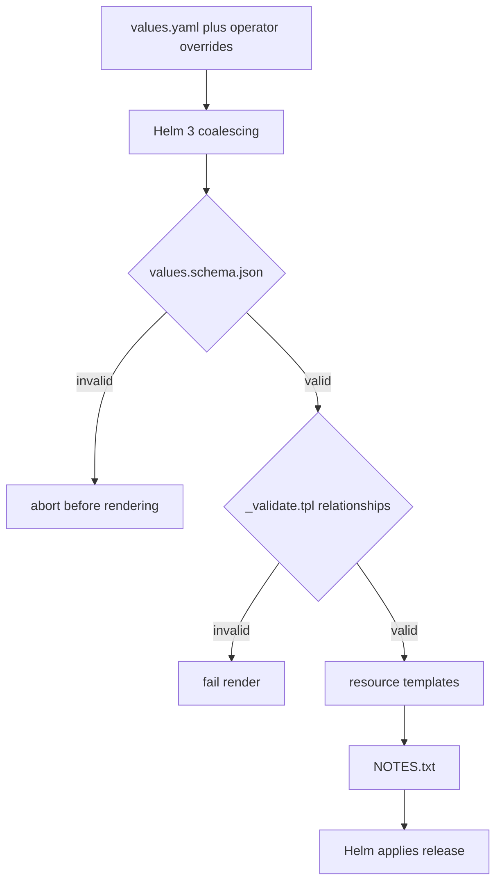

# Design Document

## Overview

The implementation has two related changes:

1. package the Kubernetes resources as a Helm 3 chart; and
2. make the sync agent maintain `datasetRoot` as a direct mirror of the ONTAP
   source.

The chart is intentionally conventional. Static defaults are normal YAML values,
optional resources use booleans, Karpenter requirements are a replaceable list,
and capacities are explicit quantities. Templates validate only relationships
that the values schema cannot express. They do not call `lookup`, retain objects
outside Helm ownership, compare releases, or calculate storage policy.

The sync agent runs exactly `rclone sync <source>/ <datasetRoot>/` and relies on
rclone's normal temporary-file-and-rename behavior. There is no second full
staging tree and no claim of whole-tree atomicity.

## Repository layout

```text
charts/node-local-data/
  Chart.yaml
  values.yaml
  values.schema.json
  templates/
    _helpers.tpl
    _validate.tpl
    00-namespace.yaml
    01-rbac.yaml
    02-ec2nodeclass.yaml
    03-nodepool.yaml
    04-warm-capacity.yaml
    05-source-pv.yaml
    06-source-pvc.yaml
    07-sync-agent-daemonset.yaml
    08-path-shim.yaml
    09-local-pv.yaml
    NOTES.txt
examples/
  values-example.yaml
  values-instance-types.yaml
agent/
  sync_agent.py
  tests/
tests/chart/
  conftest.py
  test_render.py
  requirements-dev.txt
scripts/
  check-placeholders.sh
```

The numbered template files preserve the existing resource grouping and make
review against the source manifests straightforward. The chart, not a generated
copy under `manifests/`, becomes the maintained deployment source.

## Values interface

All static defaults below are written directly in `values.yaml`. Required
installation-specific strings are represented by empty values and rejected by
`values.schema.json` until supplied by the operator.

```yaml
namePrefix: geodata

namespace:
  create: true
  name: geodata-sync

labelDomain: ""                 # required
workloadValue: geodata
datasetRoot: /mnt/geodata

image:
  repository: ""                # required
  tag: 0.5.0
  pullPolicy: IfNotPresent

nfs:
  server: ""                    # required
  shareName: ""                 # required; volume-handle component
  sharePath: ""                 # required
  capacity: ""                  # required; example uses 1536Gi
  mountOptions:
    - nfsvers=4.1
    - nconnect=16

aws:
  amiAlias: ""                  # required Karpenter family@version alias, not an EC2 AMI ID/name
  nodeRole: ""                  # required
  subnetSelectorTerms: []       # required; native EC2NodeClass term shape
  securityGroupSelectorTerms: [] # required; native EC2NodeClass term shape

ec2NodeClass:
  dataVolumeSize: 200Gi

nodePool:
  architectures: [amd64]
  operatingSystems: [linux]
  zones: []                      # required
  capacityTypes: [on-demand]
  instanceRequirements:
    - key: karpenter.k8s.aws/instance-category
      operator: In
      values: [c, m, r, i]
    - key: karpenter.k8s.aws/instance-generation
      operator: Gt
      values: ["7"]
    - key: karpenter.k8s.aws/instance-cpu
      operator: Gt
      values: ["7"]
    - key: karpenter.k8s.aws/instance-memory
      operator: Gt
      values: ["32767"]
    - key: karpenter.k8s.aws/instance-local-nvme
      operator: Gt
      values: ["1199"]
    - key: karpenter.k8s.aws/instance-network-bandwidth
      operator: Gt
      values: ["16000"]
  limits:
    nodes: 3
    cpu: 144

warmCapacity:
  enabled: true
  replicas: 2
  priority: -10
  image: registry.k8s.io/pause:3.10

syncAgent:
  intervalSeconds: 300
  transfers: 8
  multiThreadStreams: 8
  excludes: ["*.zip.*", "*.zip"]
  memory: 1Gi
  terminationGracePeriodSeconds: 4800

pathShim:
  enabled: true
  image: public.ecr.aws/amazonlinux/amazonlinux:2023

localVolume:
  enabled: false
  capacity: 600Gi
  accessModes: [ReadOnlyMany]
```

### Why selectors and instance requirements are lists

`EC2NodeClass` already defines subnet and security-group selector term formats,
and `NodePool` already defines requirement entries. Passing those structures
through avoids chart-specific tag-versus-ID modes and floor-versus-instance-type
modes.

The chart owns only four NodePool requirement keys because they are coupled to
other top-level values:

- `kubernetes.io/arch`;
- `kubernetes.io/os`;
- `topology.kubernetes.io/zone`;
- `karpenter.sh/capacity-type`.

It appends `nodePool.instanceRequirements` after them. To pin instance types, an
operator replaces the default floor list:

```yaml
nodePool:
  instanceRequirements:
    - key: karpenter.k8s.aws/instance-type
      operator: In
      values: [r8id.8xlarge, i7i.8xlarge]
```

The chart checks only that the four managed keys are not repeated. Karpenter
validates requirement semantics and determines whether capacity is available.
The operator remains responsible for ensuring an explicit type can hold and
serve the data.

## Render pipeline



There is no cluster branch in this pipeline. `helm template`, client-side dry
runs, installs, and upgrades execute the same chart logic. Missing Karpenter
CRDs, missing NFS CSI support, and ownership conflicts are reported by
Kubernetes or Helm when the release is applied.

### Validation placement

`values.schema.json` handles:

- required and non-empty strings;
- DNS-compatible names and label values;
- booleans and integer ranges;
- Kubernetes quantity syntax;
- image pull policy and capacity-type enums;
- non-empty zones and selector-term lists;
- Karpenter requirement object shape and supported operators;
- `additionalProperties: false` for chart-owned objects.

`_validate.tpl` handles only three cross-field or contextual rules:

1. `datasetRoot` starts with `/mnt/` and has a path component below it;
2. enabled warm replicas do not exceed the NodePool node limit;
3. `instanceRequirements` do not repeat a chart-managed key.

The chart does not normalize quantities, calculate capacities, scan value
provenance, query live resources, or issue advisory warnings for every unusual
combination. Operational trade-offs belong in `values.yaml` comments and the
README.

## Shared helpers

`_helpers.tpl` provides one implementation for:

- names derived from `namePrefix`;
- release namespace selection;
- component, workload, dataset-generation, and dataset-count label keys;
- dedicated and data-not-ready taint keys;
- common labels and selectors;
- source PV, PVC, and StorageClass names;
- local PV and StorageClass names;
- `datasetRoot`;
- the NFS volume handle;
- escaped label keys used in JSONPath examples.

Helpers are used where two or more resources must agree. They are not introduced
for single-use scalar fields.

## Resource templates

### Namespace and RBAC

The Namespace is gated by `namespace.create`. The ServiceAccount, ClusterRole,
and ClusterRoleBinding retain the current security boundary: the agent may
`get`, `list`, `watch`, and `patch` nodes and has no other API permission.
Documentation retains the warning that this node patch permission is
cluster-wide.

### EC2NodeClass

The template renders the configured role, pinned AMI alias, selector-term lists,
and a `200Gi` default Bottlerocket data volume. The instance-store bootstrap
remains one essential command entry with `init` before `bind`, and the bind
target is exactly `datasetRoot`; this ordering is covered by a render assertion.

### NodePool

The template renders shared labels and taints, the four chart-managed
requirements, then the configured instance requirements. It retains:

- `expireAfter: Never`;
- no `terminationGracePeriod` field;
- `consolidationPolicy: WhenEmpty`;
- `consolidateAfter: Never`;
- one disruption budget with `nodes: "0"`.

Limits are rendered directly from `nodePool.limits`. Changing NodePool or
EC2NodeClass fields may mark NodeClaims Drifted; the chart does not attempt to
predict or report the field-level difference.

### Warm capacity

One boolean gates both the PriorityClass and Deployment. The replica count is
explicit. Required pod anti-affinity spreads replicas by hostname. Disabling
warm capacity does not delete already provisioned nodes as an immediate side
effect; after upgrade the operator may remove unneeded NodeClaims, while the
NodePool's normal scheduling and disruption configuration remains authoritative.

### Source and local volumes

The source PV and PVC receive the same `nfs.capacity` string. The local PV uses
`localVolume.capacity` and points directly at `datasetRoot`. Both StorageClasses
and PVs retain `Retain` policies to prevent a claim lifecycle from invoking
storage reclamation, but no Helm keep annotation is rendered.

The local StorageClass and PV are gated together by `localVolume.enabled`. The
recommended flow is install with the default `false`, wait for first syncs, then
upgrade with it set to `true`.

### Path shim

One boolean gates the DaemonSet. It creates `datasetRoot` on every eligible node
for ArcGIS hostPath registration. Helm uninstall removes the DaemonSet; it does
not run a cleanup command against paths it previously created.

## Sync-agent design

### Direct mirror algorithm

Each pass performs one operation over the complete source tree:

```text
ensure datasetRoot exists
rclone sync <source>/ <datasetRoot>/
if successful:
  read top-level names from datasetRoot
  update dataset-generation and dataset-count labels
  remove the data-not-ready taint
if datasetRoot is absent or empty:
  apply the data-not-ready taint
```

The invocation uses the configured concurrency and excludes. `--inplace` is
absent. Rclone transfers a changed file to a temporary name and renames it over
the destination after completion. This costs temporary space for files being
replaced but prevents consumers from opening a partially transferred final path.

The agent maintains no second full staging tree and does not rename top-level
dataset directories. A failed pass is retried on the next interval. Completed
file updates may already be visible after a failed pass, so failure does not
imply rollback. Temporary files left by interruption are reconciled by a later
successful pass.

### Consistency contract

The direct mirror has per-file consistency, not snapshot consistency:

- a final file path is old or new, not partially transferred;
- additions, changes, and deletions can become visible at different times during
  one pass;
- after a successful pass, `datasetRoot` matches the included source tree
  according to rclone's size-and-modification-time comparison;
- source publication must change size or modification time for a same-named file
  to be detected without checksum mode;
- a service requiring a coordinated multi-file release must be drained or
  restarted according to the operator's ONTAP publication procedure.

This is a deliberate simplification. Whole-tree atomic replacement would require
two full trees plus a portable atomic-swap mechanism and a consumer
remount/restart contract. That complexity is not justified by this feature.

### Readiness labels

The dataset-generation label is a digest of sorted top-level directory names in
`datasetRoot`, and dataset-count is their count. They are readiness/observability
signals, not content checksums. Modifying files without changing top-level names
does not change the dataset-generation label; logs and the successful-pass
timestamp are used to observe such updates. Readiness and emptiness checks also
inspect `datasetRoot` directly.

## Lifecycle

All rendered objects remain ordinary members of the Helm release:

- install creates enabled objects;
- upgrade updates or removes objects according to the new values;
- uninstall requests deletion of every rendered object.

No `helm.sh/resource-policy: keep`, pre-delete hook, finalizer, or cleanup Job is
used. `Retain` reclaim policies remain on static storage objects, but they do not
prevent Helm from deleting those objects.

Lifecycle changes that disable ArcGIS integration resources require operator
preparation before the upgrade:

- before changing `localVolume.enabled` from `true` to `false`, the operator
  deregisters the local-PV ArcGIS data store. If an ArcGIS-owned claim is bound
  to the local PV, the operator deletes that claim and verifies that it no
  longer exists before invoking `helm upgrade`;
- before changing `pathShim.enabled` from `true` to `false`, the operator
  deregisters the routing hostPath ArcGIS data store before invoking
  `helm upgrade`.

After those pre-upgrade steps, Helm normally removes the resources gated by the
newly disabled value. The chart does not use a hook or force-deletion mechanism
to bypass Kubernetes protection. In particular, PV protection can leave a
bound local PV in `Terminating` after Helm requests deletion, and the chart does
not delete an external claim on the operator's behalf.

Before uninstall, the operator likewise deregisters the ArcGIS local-PV and
routing hostPath data stores. An ArcGIS-owned claim bound to the local PV must be
deleted and its removal verified before uninstall. The same PV-protection and
no-force-delete behavior applies.

Deleting the source PV object does not delete the ONTAP export. Deleting the
NodePool may terminate nodes and discard instance-store mirrors. This is
acceptable because ONTAP is the gold copy and a later installation rebuilds the
mirrors.

## Notes and operator workflow

`NOTES.txt` contains only actionable release-specific information:

1. commands to watch the sync agent and inspect dataset-generation labels in
   the rendered namespace;
2. the follow-up upgrade command when the local volume is disabled;
3. local-PV registration values when enabled, including `datasetRoot` as the
   exact PV and Enterprise Manager path;
4. `datasetRoot` as the exact routing hostPath registration path plus placement
   values when the Path Shim is enabled;
5. the cold-start consequence when warm capacity is disabled;
6. a reminder that NodePool/NodeClass changes can mark NodeClaims Drifted.

Prerequisite checks are documented, not embedded in templates:

```bash
kubectl api-resources | grep -E 'nodepools|ec2nodeclasses'
kubectl get csidriver nfs.csi.k8s.io
```

## Architecture

The repository layout defines the deployable units, and the render pipeline defines
how values become release resources. At runtime, the resource templates provision
the node, storage, and scheduling layer; the sync-agent design defines the data
path from the source volume directly into `datasetRoot`; and the lifecycle and
operator-workflow sections define the release boundary. These existing sections
are the authoritative architectural detail.

## Components and Interfaces

The values interface and schema are the chart's operator-facing configuration
contract. Shared helpers and resource templates are its internal rendering
components, while NOTES is its release-specific operator interface. The sync
agent interfaces with the mounted source, `datasetRoot`, rclone, and the
Kubernetes node API as described under Sync-agent design. Component behavior and
resource boundaries remain defined in those sections rather than repeated here.

## Data Models

The canonical configuration model is the typed values structure under Values
interface, constrained by `values.schema.json` and the three relationship checks
under Validation placement. Rendered Kubernetes and Karpenter objects are
specified under Resource templates. Sync state consists only of the direct
`datasetRoot` mirror, the startup taint, and the dataset-generation and
dataset-count node labels described under Readiness labels.

## Correctness Properties

These invariants are implemented by the focused example-based render and
sync-agent assertions in Testing Strategy; they do not require generated inputs
or a property-testing framework.

### Property 1: Rendered identifiers and capacities remain consistent

For every focused chart render, resources that share a logical identifier use
the same helper-derived value, and the source PV and PVC render the same
configured capacity.

**Validates: Requirements 1.5, 4.2**

### Property 2: Dataset paths use the direct dataset root

For every focused chart render, the EC2 bind target and each enabled local-data
path use the configured `datasetRoot` directly.

**Validates: Requirements 4.4, 4.5, 6.5**

### Property 3: Successful syncs establish mirror readiness

For every targeted successful sync scenario, the agent invokes one direct
`rclone sync` into `datasetRoot` without `--inplace`, then updates readiness
labels and removes the startup taint; an absent or empty `datasetRoot` reapplies
the taint.

**Validates: Requirements 5.1, 5.3, 5.4, 5.6, 5.7**

## Error Handling

Invalid values are rejected by the schema or one of the three scoped template
relationship checks before resources are rendered. Apply-time API, ownership,
and capacity failures are reported by Helm, Kubernetes, or Karpenter. A failed
sync pass leaves completed per-file changes intact, keeps or reapplies the
startup taint when `datasetRoot` is absent or empty, and is retried on the next
interval; Lifecycle describes protected-resource behavior during upgrade and
uninstall.

## Testing Strategy

Implementation deletes the raw files under `manifests/` and retains the chart
plus documented example values as the sole maintained deployment source.
Maintained-content migration also updates `RESULTS.md`: it preserves the
historical test conditions, measured performance findings, and their
single-environment qualifications, while identifying raw-manifest validation as
historical and no longer the current deployment validation. It separately
states the validation status of the Helm chart and direct-mirror sync-agent
implementation so historical measurements are not presented as qualification
of the migrated implementation.

The chart suite renders a focused matrix:

| Case | Purpose |
|---|---|
| documented example, local volume off | default first-stage install |
| documented example, local volume on | complete resource set and registration notes |
| explicit instance types | replaceable requirements list |
| warm capacity off | optional resource isolation |
| Path Shim off | omit only the Path Shim DaemonSet and preserve every unrelated rendered resource from the enabled baseline |
| namespace creation off | omit the Namespace and place every namespaced resource in `namespace.name` |
| representative invalid values | schema and three relationship failures |

Assertions cover resource counts, shared names and references, source PV/PVC
capacity equality, explicit local and EBS capacities, NodePool safety settings,
bootstrap command order, RBAC scope, and absence of placeholders. The Path Shim
disablement case compares against the enabled baseline after excluding only the
Path Shim DaemonSet and requires all unrelated rendered resources to remain
identical, covering Requirements 6.8 and 9.3. The namespace-creation-disabled
case requires no Namespace object and verifies that every namespaced resource
uses `namespace.name`, covering Requirement 1.6.

Sync-agent behavior and readiness tests cover source additions, modifications,
deletions, exclusions, transfer failure, absence of `--inplace`, first-sync taint
removal, empty-`datasetRoot` re-tainting, and top-level label updates. The
required real-rclone integration scenarios cover source addition, source
modification, source deletion, configured excludes, and interrupted-pass retry.

Repository acceptance requires all of the following, with no optional test
category: chart render tests; sync-agent behavior and readiness tests; the
required real-rclone integration scenarios; and the final validation commands.
The required validation environment provides exactly rclone `1.75.0`, matching
the supported sync-agent image. Before the real-rclone scenarios run, validation
checks the executable and version. If rclone is absent or reports any other
version, required integration validation fails with the version requirement; it
does not mark those scenarios skipped. Unit tests unrelated to the real-rclone
contract may continue to use mocks or other practical isolation.

Property-based testing is not used: the chart is declarative rendering and
configuration validation, while the sync behavior is process and filesystem
integration. Focused example-based render tests and targeted integration tests
match these risks directly.

The mandatory final validation commands are:

```bash
helm lint --strict charts/node-local-data -f examples/values-example.yaml
pytest -q tests/chart agent/tests
./scripts/check-placeholders.sh
```

Each command must complete successfully in the required validation environment;
none substitutes for the mandatory chart, sync-agent, or real-rclone scenario
coverage described above.

No cluster-dependent chart suite, exact comment-order test, README parser,
custom drift script, or exhaustive warning suite is part of the design.

## Requirements traceability

| Requirement | Design element |
|---|---|
| 1. The deployment is packaged as a conventional Helm chart | Repository layout, values interface, render pipeline |
| 2. Values and validation are explicit and unsurprising | Values interface, validation placement |
| 3. NodePool instance selection is configurable through one list | Replaceable `instanceRequirements` list, NodePool template |
| 4. Storage capacities are explicit | Values interface, source/local volume and EC2NodeClass templates |
| 5. The sync agent mirrors the ONTAP source | Direct mirror algorithm, consistency contract, readiness labels |
| 6. Optional components use direct enablement and counts | Warm capacity, Path Shim, and local volume gates |
| 7. Installation, upgrade, and uninstall follow Helm semantics | Lifecycle pre-upgrade and uninstall flows; normal Helm removal; PV protection; no hooks, lookup, keep policy, or force deletion |
| 8. ArcGIS registration guidance uses rendered values | NOTES workflow using rendered `datasetRoot` values |
| 9. Deployment source and validation are focused | Sole deployment source; mandatory chart, agent, exact-rclone, and command validation; `RESULTS.md` historical migration |
